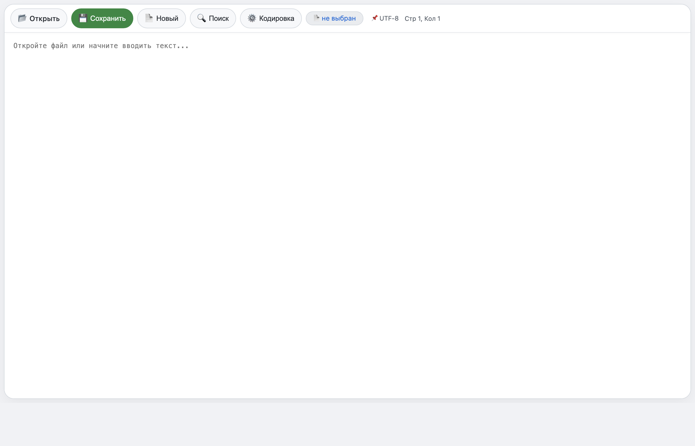

# Лёгкий Блокнот · Pro

Офлайн-блокнот в одном HTML-файле: автосохранение черновика, работа с кодировками и поиск/замена. Устанавливается как PWA на iPhone, iPad, Android и десктоп.

**Демо:** https://sergvax.github.io/MyNotepad5/



## Возможности

- 📂 **Открытие и сохранение файлов** — выберите файл, отредактируйте и сохраните под тем же или новым именем.
- 💾 **Автосохранение черновика** — текст сохраняется в `localStorage` и восстанавливается при следующем открытии.
- ⚙️ **Кодировки** — чтение с автоопределением и сохранение в UTF-8, Windows-1251, KOI8-R, ISO-8859-5, MacCyrillic, UTF-16 LE/BE.
- 🔍 **Поиск и замена** — поиск с учётом регистра, замена текущего совпадения или всех сразу.
- 📱 **PWA / офлайн** — service worker кэширует приложение, установка на домашний экран с полноэкранным режимом.
- 🌗 **Тёмная тема** — автоматически подстраивается под системную.
- ⌨️ **Горячие клавиши** — `Ctrl/Cmd+S` сохранить, `Ctrl/Cmd+F` поиск.
- 🖱️ **Drag & drop** — перетащите файл прямо в редактор.

## Установка на iPhone / iPad

1. Откройте [демо](https://sergvax.github.io/MyNotepad5/) в Safari.
2. Нажмите **«Поделиться»** → **«На экран „Домой“»**.
3. Запустите приложение с домашнего экрана — оно работает офлайн.

## Локальный запуск

Достаточно открыть `index.html` в браузере. Для проверки service worker и установки PWA нужен HTTP(S)-сервер:

```bash
python3 -m http.server 8080
# затем откройте http://localhost:8080/
```

Для установки на iPhone по локальной сети можно использовать HTTPS-сервер из репозитория (сертификат создаётся в `.cert/`):

```bash
python3 serve_https.py
```

## Структура проекта

```
index.html          # приложение (разметка, стили и логика)
manifest.json       # манифест PWA
sw.js               # service worker (офлайн-кэш)
icons/              # иконки приложения
serve_https.py      # локальный HTTPS-сервер для установки PWA на iOS
vercel.json         # конфигурация деплоя на Vercel
```

## Лицензия

[MIT](LICENSE)
